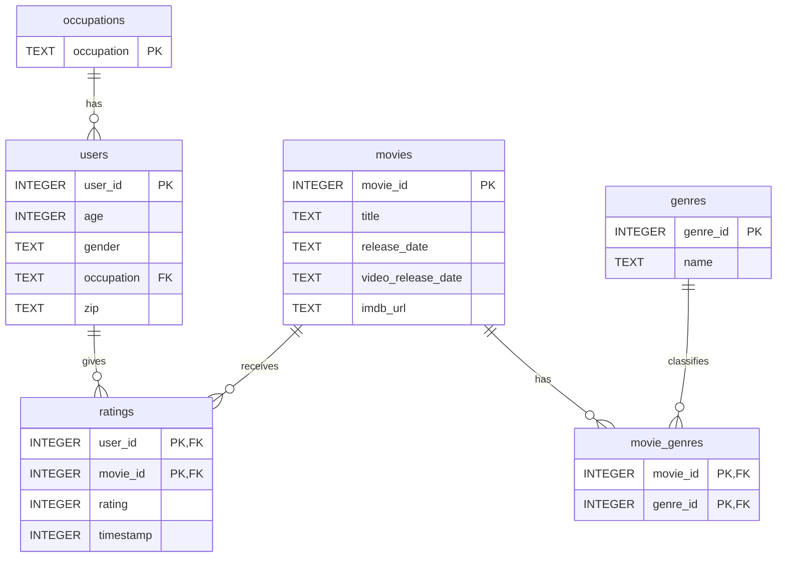

# DS5110 Homework 3 — MovieLens 100K

## Project Overview

This is a collaborative project for DS5110. The project explores the MovieLens 100K dataset and uses Python, pandas, and SQLite for data processing, database design, and analysis.

## Dataset

- **Source:** [GroupLens MovieLens 100K](https://grouplens.org/datasets/movielens/100k/)
- **Download URL:** https://files.grouplens.org/datasets/movielens/ml-100k.zip
- **Dataset:** 100,000 ratings, 943 users, and 1,682 movies
- **SHA-256 (local ZIP):** `50d2a982c66986937beb9ffb3aa76efe955bf3d5c6b761f4e3a7cd717c6a3229`

The raw dataset and generated SQLite database are excluded from Git.

## Download Instructions

Run the following command from the project root:

```bash
make
```

`make` downloads and extracts the dataset if needed, runs a strict load that records refused rows in `output/rejected.csv`, then clears and reloads the database from all raw files using `src/reload.py`. The second stage does not overwrite the rejection report. Use `make download` to acquire the data without rebuilding the database, or `make clean` to remove generated database and rejection files.

## Project Structure 

## Database Schema (ER Diagram)




- `Notebooks/` — Exploratory data analysis
- `src/` — Data downloading and database loading scripts
- `sql/` — Database schema and SQL queries
- `data/` — Downloaded raw data and generated database (not committed)
- `output/` — Generated refusal report

See [`writeup.md`](./writeup.md) for Step 3 row-count predictions and load results.

## Team Collaboration

Team members will work on separate Git branches and submit pull requests for review before merging into `main`.

## AI Assistance

ChatGPT was used for explanations, debugging guidance, and assistance with code structure and documentation. All generated suggestions should be reviewed and tested by the team.

## Status

Work in progress. Initial data exploration and dataset download functionality have been implemented. SQL loading have been implemented.
