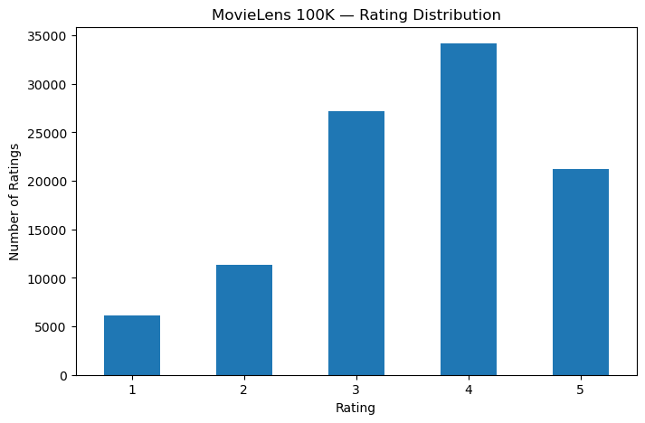
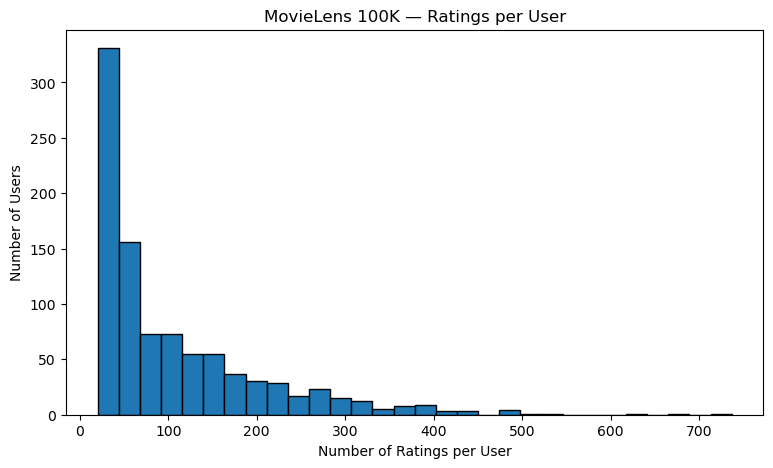

# Step 0 – Describe the Raw Data 





## 0(a) Raw Data Inspection

We used Python and pandas to inspect the three main raw files in the MovieLens 100K dataset before designing the SQLite database.

| Raw file | Rows | Columns | One row represents |
|---|---:|---:|---|
| `u.user` | 943 | 5 | One user and their demographic information |
| `u.item` | 1,682 | 24 | One movie and its metadata, including 19 genre indicators |
| `u.data` | 100,000 | 4 | One rating submitted by a user for a movie |

The `u.user` file contains user ID, age, gender, occupation, and ZIP code. The `u.item` file contains movie metadata, including title, release date, IMDb URL, and genre flags. The `u.data` file contains user ID, movie ID, rating, and timestamp.

The first few rows of each dataset are displayed in `Notebooks/01_exploration.ipynb`, which also contains our exploratory analysis.

## 0(b) Tidy Data Assessment

**`u.user`:** Each row represents one user, and each column represents one attribute of that user. The file follows tidy data principles because each user is represented by a single observation.

**`u.data`:** Each row represents one user–movie rating. The columns contain the user ID, movie ID, rating, and timestamp. This file is tidy because each rating is one observation and each variable has its own column.

**`u.item`:** Each row represents one movie. Most movie attributes are stored in separate columns, but genre membership is represented by 19 binary indicator columns. This is a wide representation of the movie–genre relationship rather than a normalized relational structure.

For our SQLite database, we convert these indicators into separate `genres` and `movie_genres` tables. This allows one movie to belong to multiple genres without storing a separate column for every possible genre.

## 0(c) File Formats and Data Quality

The three raw files use different formats and require different parsing settings.

| File | Delimiter | Encoding | Important considerations |
|---|---|---|---|
| `u.user` | Pipe (`\|`) | Not separately verified | ZIP codes must be treated as text |
| `u.item` | Pipe (`\|`) | Latin-1 | Contains 19 genre flags and missing movie metadata |
| `u.data` | Tab (`\t`) | Not separately verified | Ratings and timestamps should be parsed as integers |

**Delimiters and encoding:** The `u.user` and `u.item` files use pipe-separated values, while `u.data` is tab-separated. During database loading, UTF-8 decoding caused some movie records to be rejected. Using Latin-1 encoding allowed those movie titles to be read correctly.

**README discrepancy:** The original MovieLens 100K README describes `u.item` and `u.user` as tab-separated files. However, inspection of the actual raw files shows that both use pipe (`|`) delimiters, while `u.data` is tab-separated. We therefore used the observed delimiters when parsing the files rather than relying solely on the README descriptions.

**Column types:** User IDs, movie IDs, ratings, and timestamps are stored as integers. ZIP codes are stored as text because they are identifiers rather than quantities. Treating them as integers could remove leading zeros.

**Missing values:** Some movie metadata fields are blank, including release dates, video release dates, and IMDb URLs. These optional fields can be represented as SQL `NULL` values. Required fields remain subject to the schema's `NOT NULL` constraints.

**Data quality checks:** The database schema enforces valid rating ranges, primary keys, foreign keys, and required fields. Additional SQL queries are needed to verify dataset-level claims, such as the total number of ratings and the minimum number of ratings per user.

### Additional Validation Against the Original MovieLens README

We compared our SQLite schema with the original MovieLens 100K README to identify which documented data properties require additional validation.

The README states that user IDs and movie IDs are consecutively numbered starting from 1. Although our primary keys enforce uniqueness, they do not guarantee consecutive numbering. We therefore need SQL queries to check the minimum and maximum IDs, record counts, and missing IDs.

The README also states that each user rated at least 20 movies. This is a dataset-level requirement that cannot be enforced by our existing row-level constraints. We will verify it by grouping ratings by user and checking the minimum rating count.

The original `u.item` file contains 19 binary genre indicators, where 1 means a movie belongs to a genre and 0 means it does not. Our normalized `genres` and `movie_genres` tables represent these associations, but the original indicator values must be validated during data loading.

Finally, the README specifies that timestamps represent Unix seconds since January 1, 1970 UTC. Our `INTEGER NOT NULL` constraint ensures that timestamps are stored as integers, but it does not establish whether they represent valid Unix timestamps or correspond to the documented collection period.

These checks complement the schema constraints and help verify that the loaded database preserves the properties described in the original dataset documentation.

## 0(d) Exploratory Data Analysis

### Chart 1 – Distribution of Ratings

The first chart shows the distribution of all 100,000 ratings in the MovieLens 100K dataset. Rating 4 is the most frequent score, with 34,174 observations (34.17%), followed by rating 3 with 27,145 observations (27.15%). Ratings of 4 and 5 together account for 55.38% of all ratings.

This suggests that the observed ratings are concentrated toward higher scores. All observed ratings fall between 1 and 5, consistent with the documented rating scale.

**Follow-up check:** After loading the data into SQLite, we should verify that the database contains 100,000 ratings and that every rating satisfies the constraint `CHECK (rating BETWEEN 1 AND 5)`.

The chart and its generating code are available in `Notebooks/01_exploration.ipynb`.
### Chart 2 – Number of Ratings per User

The second chart shows the distribution of rating counts across 943 users. On average, each user contributed 106.04 ratings, while the median was 65. The minimum number of ratings was 20, and the maximum was 737.

The histogram is right-skewed: most users contributed relatively few ratings, while a small number of highly active users contributed hundreds of ratings. These highly active users raise the mean above the median.

**Follow-up check:** The observed minimum of 20 ratings per user is consistent with the MovieLens documentation. After loading the data into SQLite, we should verify this claim using a SQL query that counts ratings for every user.

The chart and its generating code are available in `Notebooks/01_exploration.ipynb`.

# Step 2 – Design the Schema

## 2(a) Entity-Relationship Diagram

The database schema consists of six tables: `users`, `occupations`, `movies`, `genres`, `movie_genres`, and `ratings`.

Primary keys uniquely identify records, while foreign keys enforce relationships between tables. The `ratings` and `movie_genres` tables use composite primary keys to prevent duplicate user–movie ratings and duplicate movie–genre associations.

The complete entity-relationship diagram is provided in `README.md` under **Database Schema (ER Diagram)**.

## 2(b) Normalization of Movie Genres

The original `u.item` file stores movie genres using 19 binary indicator columns. A movie can belong to multiple genres, so several indicators may have the value 1 in the same row.

We normalized this representation into two tables: `genres`, which stores the available genre names, and `movie_genres`, which stores the relationship between each movie and its genres.

This design represents the many-to-many relationship between movies and genres without requiring a separate column for every genre. It also avoids unnecessary schema changes when new genres are introduced and makes genre-based queries easier to express using SQL joins.

The composite primary key `(movie_id, genre_id)` prevents duplicate movie–genre associations, while foreign keys ensure that each association refers to an existing movie and genre.

## 2(c) Database Constraints and Validation

We designed the SQLite schema using `STRICT` tables, primary keys, foreign keys, `NOT NULL`, `UNIQUE`, and `CHECK` constraints to enforce data integrity.

### Rules Enforced by the Schema

| Data rule | SQLite constraint |
|---|---|
| Each user has a unique identifier | `users.user_id PRIMARY KEY` |
| Each movie has a unique identifier | `movies.movie_id PRIMARY KEY` |
| User age must be positive | `CHECK (age > 0)` |
| Gender must be M or F | `CHECK (gender IN ('M', 'F'))` |
| Each user's occupation must be valid | `REFERENCES occupations(occupation)` |
| Ratings must be integers between 1 and 5 | `INTEGER NOT NULL CHECK (rating BETWEEN 1 AND 5)` in a `STRICT` table |
| Each rating must reference an existing user and movie | Foreign keys in `ratings` |
| Each user–movie pair can occur only once in `ratings` | Composite primary key `(user_id, movie_id)` |
| Each movie–genre association must be unique | Composite primary key `(movie_id, genre_id)` |
| Each movie–genre association must reference valid records | Foreign keys in `movie_genres` |
| Required fields must not be missing | `NOT NULL` constraints |

We enable foreign key enforcement using `PRAGMA foreign_keys = ON` for database connections.

### Rules Requiring Additional Validation

Some dataset-level claims cannot be enforced by ordinary row-level constraints alone.

These include:

- The dataset contains exactly 943 users, 1,682 movies, and 100,000 ratings.
- User IDs and movie IDs are consecutively numbered starting from 1.
- Every user has rated at least 20 movies.
- The dataset contains the expected number of occupations and genres.

These claims must be checked after loading the data using SQL queries that count records, examine ID ranges, detect gaps, and calculate rating counts per user.

The schema also does not fully validate the semantic correctness of movie metadata, such as whether a movie title, release date, or IMDb URL is factually accurate.

We therefore use both schema constraints and post-loading validation queries to assess data integrity.

## 2(d) ZIP Code Data Type

We store ZIP codes as `TEXT` rather than `INTEGER` because ZIP codes are identifiers, not numerical quantities. Using an integer type could remove leading zeros, such as converting `02115` to `2115`. Storing ZIP codes as text preserves their original formatting and supports ZIP codes containing non-numeric characters.

# Step 3 — Load the data and keep what is refused

## Predictions

The loader uses UTF-8 decoding, with date format of `DD-MMM-YYYY`, does not allow blank required fields, and retains blank optional movie
fields as `NULL`. Scanning the source data, some movie has invalid characters, and some ratings & genres will be dropped because of the rejection of those movies. Due to the amount of data, I can only estimate on how many rows will be rejected.

| Table | Predicted rows | Basis |
|---|---:|---|
| `occupations` | 21 | One row per line in `u.occupation` |
| `users` | 943 | One row per record in `u.user` |
| `movies` | 1,680 | 1,682 source rows in `u.item`, some rows have illegal char |
| `genres` | 19 | The 19 named genre IDs in `u.genre` |
| `movie_genres` | 2,000 | Most movies have 1-3 genres, 2000 is a good estimate on a tidy form of genres with movies|
| `ratings` | 99,950| 100,000 source rows, some ratings are associated with refused movies |
| Rejected records | 52 | 2 movie rows plus 50 ratings with missing movie references |


## Results 1

| Table | Predicted rows | Actual rows | Difference | Reason|
|---|---:|---:|---:|---:|
| `occupations` | 21 | 21 | 0 |  |
| `users` | 943 | 943 | 0 |  |
| `movies` | 1,680 | 1,672 | 8| More movies have illegal characters |
| `genres` | 19 | 19 | 0 |  |
| `movie_genres` | 2,000| 2,878 | 0 | The initial estimate was not accurate. More genres than we thought |
| `ratings` | 99,950| 99,926 | 0 | Expected less rating being dropped. Actuallly more |
| Rejected records | 52| 84 | 0 |  |

The rejections were fixable. We can change the decode format to allow the non-utf8 characters. Also, there was a line rejected for bad date foramt: `u.item,1373,movies,"[""1373"", ""Good Morning (1971)"", ""4-Feb-1971"", """", ""http://us.imdb.com/M/title-exact?Good%20Morning%20(1971)"", ""1"", ""0"", ""0"", ""0"", ""0"", ""0"", ""0"", ""0"", ""0"", ""0"", ""0"", ""0"", ""0"", ""0"", ""0"", ""0"", ""0""]",invalid release date '4-Feb-1971'; expected DD-MMM-YYYY`. This should be accepted because the cell itself has valid data. The dropped ratings should also be included after changing decoding method.

## Follow-up: reload all source rows

The Makefile now runs `src/load.py` first, then `src/reload.py`. The second script clears and rebuilds
`data/movielens.db` from all raw files; it decodes the text as Latin-1 and keeps release dates as source text. Empty optional movie fields (release date, video-release date, and IMDb URL) are stored as SQL `NULL`, matching the nullable columns in the schema; they do not cause the movie row to be rejected. Required fields remain subject to the schema's `NOT NULL` constraints. The reload script does not write or replace the rejection CSV, so that file remains the record of what the first load rejected.

## Results 2

| Table / report | After `load.py` | After `reload.py` | Restored by reload |
|---|---:|---:|---:|
| `occupations` | 21 | 21 | 0 |
| `users` | 943 | 943 | 0 |
| `movies` | 1,672 | 1,682 | 10 |
| `genres` | 19 | 19 | 0 |
| `movie_genres` | 2,878 | 2,893 | 15 |
| `ratings` | 99,926 | 100,000 | 74 |
| Rejected rows | 84 | 0|  |

# Step 4

## Claim 1
"There are 100,000 ratings by 943 users on 1,682 movies"
This is supported by sql/queries/S4-C1.sql. This query shows the number of ratings, movies, and users.
Result:
```
sqlite> .read sql/queries/S4-C1.sql
╭───────────┬──────────┬─────────╮
│ N_RATINGS │ N_MOVIES │ N_USERS │
╞═══════════╪══════════╪═════════╡
│    100000 │     1682 │     943 │
╰───────────┴──────────┴─────────╯
```

## Claim 2

"Users and movies are numbered consecutively from 1"
 This is supported by sql/queries/S4-C2.sql. This query shows the min and max user IDs and movie IDs. The total is the total of unique IDs. If the max equals unique total, and table schema enforce all IDs to be integers, the IDs must be continuous.
Result:
```
sqlite> .read sql/queries/S4-C2.sql
╭────────┬────────┬──────────────╮
│ min_id │ max_id │ unique_total │
╞════════╪════════╪══════════════╡
│      1 │    943 │          943 │
╰────────┴────────┴──────────────╯
╭────────┬────────┬──────────────╮
│ min_id │ max_id │ unique_total │
╞════════╪════════╪══════════════╡
│      1 │   1682 │         1682 │
╰────────┴────────┴──────────────╯
```


## Claim 3

"Every user has rated at least 20 movies."
This is supported by sql/queries/S4-C3.sql. This query shows the 10 users with least ratings in the dataset.
Result:
```
sqlite> .read sql/queries/S4-C3.sql
╭─────────┬──────────────╮
│ user_id │ rating_count │
╞═════════╪══════════════╡
│      19 │           20 │
│      34 │           20 │
│      36 │           20 │
│      93 │           20 │
│     143 │           20 │
│     147 │           20 │
│     166 │           20 │
│     202 │           20 │
│     242 │           20 │
│     300 │           20 │
╰─────────┴──────────────╯
```

# Step 5
## Case 1
This query identifies the top 10 movies by the number of ratings, including ties. We use the RANK() window function so that movies with the same rating count receive the same rank. The results show that Star Wars (1977) has the highest number of ratings, with 583. Unlike LIMIT 10, this approach ensures that any movies tied at the cutoff rank are also included.

**Output:**
```text
SQLite-3.54 movielens.db-> .read sql/queries/S5-C1.sql


╭──────────┬───────────────────────────────┬───────────╮
│ movie_id │             title             │ N_RATINGS │
╞══════════╪═══════════════════════════════╪═══════════╡
│       50 │ Star Wars (1977)              │       583 │
│      258 │ Contact (1997)                │       509 │
│      100 │ Fargo (1996)                  │       508 │
│      181 │ Return of the Jedi (1983)     │       507 │
│      294 │ Liar Liar (1997)              │       485 │
│      286 │ English Patient, The (1996)   │       481 │
│      288 │ Scream (1996)                 │       478 │
│        1 │ Toy Story (1995)              │       452 │
│      300 │ Air Force One (1997)          │       431 │
│      121 │ Independence Day (ID4) (1996) │       429 │
╰──────────┴───────────────────────────────┴───────────╯
```
## Case 2
Case 2 returns the occupations and their mean ratings. WHERE filters the rows before grouping while HAVING filters the whole group after the aggregate is calculated. At least 50 raters condition belongs in HAVING because it describes the number of users in an occupation. A row level filter condition belongs to WHERE which describes the property of a single rating.
**Output:**
```text

SQLite-3.54 movielens.db-> .read sql/queries/S5-C2.sql
╭───────────────┬────────────────────╮
│  occupation   │    mean_ratings    │
╞═══════════════╪════════════════════╡
│ administrator │ 3.6356464768017114 │
│ educator      │ 3.6706206312221985 │
│ engineer      │  3.541406727828746 │
│ librarian     │ 3.5607813388962639 │
│ other         │ 3.5523773797242804 │
│ programmer    │ 3.5682604794257147 │
│ student       │ 3.5151432345038027 │
╰───────────────┴────────────────────╯
```
## Case 3
Case 3 returns the zip code where the code doesn't start with a digit. If zip were stored as a integer, the non-numeric zip codes would be rejected because of STRICT and the numeric zip codes would lose the leading zeros. This is why zip code is a text.

**Output:**
```text

SQLite-3.54 movielens.db-> .read sql/queries/S5-C3.sql
╭─────────┬───────╮
│ user_id │  zip  │
╞═════════╪═══════╡
│      74 │ T8H1N │
│     145 │ V3N4P │
│     167 │ L9G2B │
│     201 │ E2A4H │
│     333 │ V0R2M │
│     458 │ Y1A6B │
│     490 │ V5A2B │
│     578 │ M7A1A │
│     594 │ M4J2K │
│     599 │ R3T5K │
│     634 │ T8H1N │
│     709 │ N4T1A │
│     719 │ V0R2H │
│     779 │ K7L5J │
│     857 │ V1G4L │
│     901 │ L1V3W │
│     916 │ N2L5N │
│     923 │ E2E3R │
╰─────────┴───────╯
```
## Case 4
The total is more than 100000 because a movie can consist of mutiple genres and joining ratings to movie_genres repeats each rating once for every genre of that movie. The sum counts the rating and movie_genre pairs and not individal ratings. Checking it showed that no there are no movies_without_genres and rating_without_genres so the difference is because of multiple genres.

**Output:**
```text

SQLite-3.54 movielens.db-> .read sql/queries/S5-C4.sql
╭─────────────┬───────────┬────────────────────╮
│ genre_name  │ N_RATINGS │    mean_ratings    │
╞═════════════╪═══════════╪════════════════════╡
│ Action      │     25589 │ 3.4802454179530269 │
│ Adventure   │     13753 │ 3.5035265033083691 │
│ Animation   │      3605 │ 3.5766990291262135 │
│ Children's  │      7182 │ 3.3532442216652743 │
│ Comedy      │     29832 │ 3.3940734781442745 │
│ Crime       │      8055 │ 3.6322780881440098 │
│ Documentary │       758 │ 3.6728232189973613 │
│ Drama       │     39895 │ 3.6873793708484772 │
│ Fantasy     │      1352 │ 3.2152366863905324 │
│ Film-Noir   │      1733 │ 3.9215233698788228 │
│ Horror      │      5317 │ 3.2903893172841827 │
│ Musical     │      4954 │ 3.5213968510294711 │
│ Mystery     │      5245 │ 3.6381315538608199 │
│ Romance     │     19461 │ 3.6217049483582549 │
│ Sci-Fi      │     12730 │ 3.5607227022780834 │
│ Thriller    │     21872 │ 3.5090069495245064 │
│ War         │      9398 │ 3.8158118748669931 │
│ Western     │      1854 │ 3.6132686084142396 │
│ unknown     │        10 │                3.2 │
╰─────────────┴───────────┴────────────────────╯
╭────────╮
│ total  │
╞════════╡
│ 212595 │
╰────────╯
╭────────┬─────────────────╮
│ total  │ equal_to_100000 │
╞════════╪═════════════════╡
│ 212595 │               0 │
╰────────┴─────────────────╯
╭──────────────────────╮
│ movies_without_ge... │
╞══════════════════════╡
│                    0 │
╰──────────────────────╯
╭──────────────────────╮
│ rating_without_ge... │
╞══════════════════════╡
│                    0 │
╰──────────────────────╯
```
## Case 5
**Case 5 — Number of Ratings per Calendar Month**

This query counts the number of ratings submitted during each calendar month. The Unix timestamp is converted into a date, and `strftime('%Y-%m', ...)` extracts the year and month. Grouping by this value ensures that ratings from the same month in different years are counted separately.

The results are ordered chronologically, making it possible to examine how rating activity changes over time. The total number of ratings across all calendar months should equal 100,000, consistent with the dataset validation in Step 4.
```text

SQLite-3.54 movielens.db-> .read sql/queries/S5-C5.sql
╭──────────┬───────┬───────────╮
│ movie_id │ month │ n_ratings │
╞══════════╪═══════╪═══════════╡
│      474 │ 01    │     14095 │
│      346 │ 02    │     10991 │
│       40 │ 03    │     12656 │
│      302 │ 04    │      9359 │
│     1042 │ 09    │      6704 │
│      222 │ 10    │     10304 │
│      377 │ 11    │     23980 │
│      242 │ 12    │     11911 │
╰──────────┴───────┴───────────╯
```
## Case 6
The result of case 6 is movies where it was rated by at least one student but by no programmer. EXCEPT fits in this situation because it returns the result in the first query but not in the second. So, it removed the movies appearing in the second result from the first result. UNION and INTERSECTION do not fit becasue union combines the results and INTERSECTION returns the common results.

**Output:**
```text
SQLite-3.54 movielens.db-> .read sql/queries/S5-C1.sql
SQLite-3.54 movielens.db-> .read sql/queries/S5-C6.sql
╭──────────┬────────────────────────────────────────────────────────────────────╮
│ movie_id │                               title                                │
╞══════════╪════════════════════════════════════════════════════════════════════╡
│        6 │ Shanghai Triad (Yao a yao yao dao waipo qiao) (1995)               │
│       36 │ Mad Love (1995)                                                    │
│       37 │ Nadja (1994)                                                       │
│       57 │ Priest (1994)                                                      │
│       74 │ Faster Pussycat! Kill! Kill! (1965)                                │
│      104 │ Theodore Rex (1995)                                                │
│      113 │ Horseman on the Roof, The (Hussard sur le toit, Le) (1995)         │
│      149 │ Jude (1996)                                                        │
│      256 │ When the Cats Away (Chacun cherche son chat) (1996)                │
│      266 │ Kull the Conqueror (1997)                                          │
│      296 │ Promesse, La (1996)                                                │
│      309 │ Deceiver (1997)                                                    │
│      314 │ 3 Ninjas: High Noon At Mega Mountain (1998)                        │
│      337 │ House of Yes, The (1997)                                           │
│      341 │ Critical Care (1997)                                               │
│      353 │ Deep Rising (1998)                                                 │
│      359 │ Assignment, The (1997)                                             │
│      361 │ Incognito (1997)                                                   │
│      370 │ Mary Reilly (1996)                                                 │
│      371 │ Bridges of Madison County, The (1995)                              │
│      376 │ Houseguest (1994)                                                  │
│      387 │ Age of Innocence, The (1993)                                       │
│      400 │ Little Rascals, The (1994)                                         │
│      406 │ Thinner (1996)                                                     │
│      440 │ Amityville II: The Possession (1982)                               │
│      453 │ Jaws 3-D (1983)                                                    │
│      493 │ Thin Man, The (1934)                                               │
│      536 │ Ponette (1996)                                                     │
│      545 │ Vampire in Brooklyn (1995)                                         │
│      555 │ White Man's Burden (1995)                                          │
│      574 │ Boxing Helena (1993)                                               │
│      590 │ Hellraiser: Bloodline (1996)                                       │
│      592 │ True Crime (1995)                                                  │
│      601 │ For Whom the Bell Tolls (1943)                                     │
│      634 │ Microcosmos: Le peuple de l'herbe (1996)                           │
│      639 │ Tin Drum, The (Blechtrommel, Die) (1979)                           │
│      669 │ Body Parts (1991)                                                  │
│      681 │ Wishmaster (1997)                                                  │
│      691 │ Dark City (1998)                                                   │
│      694 │ Persuasion (1995)                                                  │
│      695 │ Kicking and Screaming (1995)                                       │
│      703 │ Widows' Peak (1994)                                                │
│      706 │ Bad Moon (1996)                                                    │
│      714 │ Carrington (1995)                                                  │
│      757 │ Across the Sea of Time (1995)                                      │
│      766 │ Man of the Year (1995)                                             │
│      767 │ Addiction, The (1995)                                              │
│      776 │ Three Wishes (1995)                                                │
│      777 │ Castle Freak (1995)                                                │
│      782 │ Little Odessa (1994)                                               │
│      786 │ Perez Family, The (1995)                                           │
│      787 │ Roommates (1995)                                                   │
│      791 │ Baby-Sitters Club, The (1995)                                      │
│      798 │ Bad Company (1995)                                                 │
│      799 │ Boys Life (1995)                                                   │
│      803 │ Heaven & Earth (1993)                                              │
│      807 │ Poetic Justice (1993)                                              │
│      811 │ Thirty-Two Short Films About Glenn Gould (1993)                    │
│      821 │ Mrs. Winterbourne (1996)                                           │
│      828 │ Alaska (1996)                                                      │
│      839 │ Loch Ness (1995)                                                   │
│      851 │ Two or Three Things I Know About Her (1966)                        │
│      859 │ April Fool's Day (1986)                                            │
│      860 │ Believers, The (1987)                                              │
│      867 │ Whole Wide World, The (1996)                                       │
│      870 │ Touch (1997)                                                       │
│      877 │ Excess Baggage (1997)                                              │
│      883 │ Telling Lies in America (1997)                                     │
│      884 │ Year of the Horse (1997)                                           │
│      885 │ Phantoms (1998)                                                    │
│      888 │ One Night Stand (1997)                                             │
│      889 │ Tango Lesson, The (1997)                                           │
│      891 │ Bent (1997)                                                        │
│      893 │ For Richer or Poorer (1997)                                        │
│      894 │ Home Alone 3 (1997)                                                │
│      896 │ Sweet Hereafter, The (1997)                                        │
│      899 │ Winter Guest, The (1997)                                           │
│      903 │ Afterglow (1997)                                                   │
│      905 │ Great Expectations (1998)                                          │
│      908 │ Half Baked (1998)                                                  │
│      909 │ Dangerous Beauty (1998)                                            │
│      910 │ Nil By Mouth (1997)                                                │
│      918 │ City of Angels (1998)                                              │
│      920 │ Two Bits (1995)                                                    │
│      937 │ Thousand Acres, A (1997)                                           │
│      953 │ Unstrung Heroes (1995)                                             │
│      964 │ Month by the Lake, A (1995)                                        │
│      967 │ Little Lord Fauntleroy (1936)                                      │
│      970 │ Hear My Song (1991)                                                │
│      980 │ Mother Night (1996)                                                │
│      981 │ Dangerous Ground (1997)                                            │
│      983 │ Rich Man's Wife, The (1996)                                        │
│      996 │ Big Green, The (1995)                                              │
│      997 │ Stuart Saves His Family (1995)                                     │
│     1002 │ Pest, The (1997)                                                   │
│     1003 │ That Darn Cat! (1997)                                              │
│     1005 │ Double vie de Véronique, La (Double Life of Veronique, The) (1991) │
│     1024 │ Mrs. Dalloway (1997)                                               │
│     1026 │ Lay of the Land, The (1997)                                        │
│     1038 │ Switchback (1997)                                                  │
│     1043 │ Rent-a-Kid (1995)                                                  │
│     1056 │ Cronos (1992)                                                      │
│     1058 │ War, The (1994)                                                    │
│     1062 │ Four Days in September (1997)                                      │
│     1068 │ Star Maker, The (Uomo delle stelle, L') (1995)                     │
│     1071 │ Party Girl (1995)                                                  │
│     1077 │ Love and a .45 (1994)                                              │
│     1080 │ Celestial Clockwork (1994)                                         │
│     1081 │ Curdled (1996)                                                     │
│     1082 │ Female Perversions (1996)                                          │
│     1083 │ Albino Alligator (1996)                                            │
│     1085 │ Carried Away (1996)                                                │
│     1092 │ Dear God (1996)                                                    │
│     1111 │ Double Happiness (1994)                                            │
│     1116 │ Mark of Zorro, The (1940)                                          │
│     1117 │ Surviving Picasso (1996)                                           │
│     1127 │ Truman Show, The (1998)                                            │
│     1129 │ Chungking Express (1994)                                           │
│     1131 │ Safe (1995)                                                        │
│     1141 │ War Room, The (1993)                                               │
│     1143 │ Hard Eight (1996)                                                  │
│     1146 │ Calendar Girl (1993)                                               │
│     1148 │ Tom & Viv (1994)                                                   │
│     1150 │ Last Dance (1996)                                                  │
│     1152 │ In Love and War (1996)                                             │
│     1154 │ Alphaville (1965)                                                  │
│     1155 │ Rendezvous in Paris (Rendez-vous de Paris, Les) (1995)             │
│     1156 │ Cyclo (1995)                                                       │
│     1157 │ Relic, The (1997)                                                  │
│     1158 │ Fille seule, La (A Single Girl) (1995)                             │
│     1167 │ Sum of Us, The (1994)                                              │
│     1168 │ Little Buddha (1993)                                               │
│     1171 │ Wild Reeds (1994)                                                  │
│     1172 │ Women, The (1939)                                                  │
│     1175 │ Hugo Pool (1997)                                                   │
│     1176 │ Welcome To Sarajevo (1997)                                         │
│     1177 │ Dunston Checks In (1996)                                           │
│     1184 │ Endless Summer 2, The (1994)                                       │
│     1187 │ Switchblade Sisters (1975)                                         │
│     1189 │ Prefontaine (1997)                                                 │
│     1192 │ Boys of St. Vincent, The (1993)                                    │
│     1193 │ Before the Rain (Pred dozhdot) (1994)                              │
│     1194 │ Once Were Warriors (1994)                                          │
│     1204 │ To Be or Not to Be (1942)                                          │
│     1211 │ Blue Sky (1994)                                                    │
│     1212 │ Flesh and Bone (1993)                                              │
│     1213 │ Guilty as Sin (1993)                                               │
│     1214 │ In the Realm of the Senses (Ai no corrida) (1976)                  │
│     1227 │ Awfully Big Adventure, An (1995)                                   │
│     1233 │ Nénette et Boni (1996)                                             │
│     1237 │ Twisted (1996)                                                     │
│     1241 │ Van, The (1996)                                                    │
│     1243 │ Night Flier (1997)                                                 │
│     1245 │ Gridlock'd (1997)                                                  │
│     1246 │ Bushwhacked (1995)                                                 │
│     1249 │ For Love or Money (1993)                                           │
│     1252 │ Contempt (Mépris, Le) (1963)                                       │
│     1254 │ Gone Fishin' (1997)                                                │
│     1270 │ Life with Mikey (1993)                                             │
│     1272 │ Talking About Sex (1994)                                           │
│     1273 │ Color of Night (1994)                                              │
│     1275 │ Killer (Bulletproof Heart) (1994)                                  │
│     1276 │ Sunset Park (1996)                                                 │
│     1278 │ Selena (1997)                                                      │
│     1281 │ Manny & Lo (1996)                                                  │
│     1287 │ Ed (1996)                                                          │
│     1289 │ Jack and Sarah (1995)                                              │
│     1292 │ Simple Wish, A (1997)                                              │
│     1294 │ Ayn Rand: A Sense of Life (1997)                                   │
│     1295 │ Kicked in the Head (1997)                                          │
│     1296 │ Indian Summer (1996)                                               │
│     1297 │ Love Affair (1994)                                                 │
│     1298 │ Band Wagon, The (1953)                                             │
│     1300 │ 'Til There Was You (1997)                                          │
│     1301 │ Stripes (1981)                                                     │
│     1313 │ Palmetto (1998)                                                    │
│     1315 │ Inventing the Abbotts (1997)                                       │
│     1316 │ Horse Whisperer, The (1998)                                        │
│     1317 │ Journey of August King, The (1995)                                 │
│     1319 │ Neon Bible, The (1995)                                             │
│     1324 │ Loaded (1994)                                                      │
│     1327 │ Captives (1994)                                                    │
│     1330 │ An Unforgettable Summer (1994)                                     │
│     1333 │ Midnight Dancers (Sibak) (1994)                                    │
│     1337 │ Larger Than Life (1996)                                            │
│     1356 │ Ed's Next Move (1996)                                              │
│     1357 │ For the Moment (1994)                                              │
│     1365 │ Johnny 100 Pesos (1993)                                            │
│     1367 │ Faust (1994)                                                       │
│     1375 │ Cement Garden, The (1993)                                          │
│     1377 │ Hotel de Love (1996)                                               │
│     1382 │ Bonheur, Le (1965)                                                 │
│     1383 │ Second Jungle Book: Mowgli & Baloo, The (1997)                     │
│     1392 │ Locusts, The (1997)                                                │
│     1393 │ Stag (1997)                                                        │
│     1394 │ Swept from the Sea (1997)                                          │
│     1395 │ Hurricane Streets (1998)                                           │
│     1396 │ Stonewall (1995)                                                   │
│     1400 │ Picture Bride (1995)                                               │
│     1401 │ M. Butterfly (1993)                                                │
│     1405 │ Boy's Life 2 (1997)                                                │
│     1409 │ Swan Princess, The (1994)                                          │
│     1416 │ No Escape (1994)                                                   │
│     1418 │ Joy Luck Club, The (1993)                                          │
│     1421 │ My Crazy Life (Mi vida loca) (1993)                                │
│     1422 │ Suture (1993)                                                      │
│     1423 │ Walking Dead, The (1995)                                           │
│     1426 │ Grace of My Heart (1996)                                           │
│     1429 │ Sliding Doors (1998)                                               │
│     1430 │ Ill Gotten Gains (1997)                                            │
│     1431 │ Legal Deceit (1997)                                                │
│     1432 │ Mighty, The (1998)                                                 │
│     1433 │ Men of Means (1998)                                                │
│     1434 │ Shooting Fish (1997)                                               │
│     1441 │ Moonlight and Valentino (1995)                                     │
│     1442 │ Scarlet Letter, The (1995)                                         │
│     1459 │ Madame Butterfly (1995)                                            │
│     1462 │ Thieves (Voleurs, Les) (1996)                                      │
│     1464 │ Stars Fell on Henrietta, The (1995)                                │
│     1466 │ Margaret's Museum (1995)                                           │
│     1467 │ Saint of Fort Washington, The (1993)                               │
│     1468 │ Cure, The (1995)                                                   │
│     1469 │ Tom and Huck (1995)                                                │
│     1470 │ Gumby: The Movie (1995)                                            │
│     1471 │ Hideaway (1995)                                                    │
│     1472 │ Visitors, The (Visiteurs, Les) (1993)                              │
│     1475 │ Bhaji on the Beach (1993)                                          │
│     1482 │ Gate of Heavenly Peace, The (1995)                                 │
│     1502 │ Naked in New York (1994)                                           │
│     1503 │ Gold Diggers: The Secret of Bear Mountain (1995)                   │
│     1504 │ Bewegte Mann, Der (1994)                                           │
│     1505 │ Killer: A Journal of Murder (1995)                                 │
│     1508 │ Babysitter, The (1995)                                             │
│     1510 │ Mad Dog Time (1996)                                                │
│     1511 │ Children of the Revolution (1996)                                  │
│     1514 │ Dream With the Fishes (1997)                                       │
│     1516 │ Wedding Gift, The (1994)                                           │
│     1517 │ Race the Sun (1996)                                                │
│     1519 │ New Jersey Drive (1995)                                            │
│     1520 │ Fear, The (1995)                                                   │
│     1521 │ Mr. Wonderful (1993)                                               │
│     1522 │ Trial by Jury (1994)                                               │
│     1523 │ Good Man in Africa, A (1994)                                       │
│     1529 │ Underground (1995)                                                 │
│     1534 │ Twin Town (1997)                                                   │
│     1539 │ Being Human (1993)                                                 │
│     1540 │ Amazing Panda Adventure, The (1995)                                │
│     1544 │ It Takes Two (1995)                                                │
│     1545 │ Frankie Starlight (1995)                                           │
│     1558 │ Aparajito (1956)                                                   │
│     1594 │ Everest (1998)                                                     │
│     1595 │ Shopping (1994)                                                    │
│     1596 │ Nemesis 2: Nebula (1995)                                           │
│     1607 │ Hurricane Streets (1998)                                           │
│     1609 │ B*A*P*S (1997)                                                     │
│     1614 │ Reluctant Debutante, The (1958)                                    │
│     1615 │ Warriors of Virtue (1997)                                          │
│     1618 │ King of New York (1990)                                            │
│     1620 │ Sixth Man, The (1997)                                              │
│     1622 │ Paris, France (1993)                                               │
│     1623 │ Cérémonie, La (1995)                                               │
│     1657 │ Target (1995)                                                      │
│     1664 │ 8 Heads in a Duffel Bag (1997)                                     │
│     1671 │ Further Gesture, A (1996)                                          │
│     1677 │ Sweet Nothing (1995)                                               │
│     1678 │ Mat' i syn (1997)                                                  │
│     1679 │ B. Monkey (1998)                                                   │
│     1680 │ Sliding Doors (1998)                                               │
╰──────────┴────────────────────────────────────────────────────────────────────╯
```
# Step 6
## Case A

-Step 1: Calculating avg rating of each movie
-Step 2: movies with 30+ ratings
-Step 3: mean rating per game
-Step 4: eligible movie vs its genre
-Step 5: at least 0.5 above genre mean

**Output:**
```text


SQLite-3.54 movielens.db-> .read sql/queries/S6-C1.sql
╭─────────────────────────────────────────────────────────────────────────────┬────────────┬───────────┬────────────┬────────────╮
│                                    title                                    │   genre    │ n_ratings │ movie_mean │ genre_mean │
╞═════════════════════════════════════════════════════════════════════════════╪════════════╪═══════════╪════════════╪════════════╡
│ Star Wars (1977)                                                            │ Action     │       583 │       4.36 │       3.48 │
│ Godfather, The (1972)                                                       │ Action     │       413 │       4.28 │       3.48 │
│ Raiders of the Lost Ark (1981)                                              │ Action     │       420 │       4.25 │       3.48 │
│ Titanic (1997)                                                              │ Action     │       350 │       4.25 │       3.48 │
│ Empire Strikes Back, The (1980)                                             │ Action     │       367 │        4.2 │       3.48 │
│ Boot, Das (1981)                                                            │ Action     │       201 │        4.2 │       3.48 │
│ Godfather: Part II, The (1974)                                              │ Action     │       209 │       4.19 │       3.48 │
│ African Queen, The (1951)                                                   │ Action     │       152 │       4.18 │       3.48 │
│ Princess Bride, The (1987)                                                  │ Action     │       324 │       4.17 │       3.48 │
│ Braveheart (1995)                                                           │ Action     │       297 │       4.15 │       3.48 │
│ Glory (1989)                                                                │ Action     │       171 │       4.08 │       3.48 │
│ Fugitive, The (1993)                                                        │ Action     │       336 │       4.04 │       3.48 │
│ Alien (1979)                                                                │ Action     │       291 │       4.03 │       3.48 │
│ Return of the Jedi (1983)                                                   │ Action     │       507 │       4.01 │       3.48 │
│ Terminator 2: Judgment Day (1991)                                           │ Action     │       295 │       4.01 │       3.48 │
│ Star Wars (1977)                                                            │ Adventure  │       583 │       4.36 │        3.5 │
│ Raiders of the Lost Ark (1981)                                              │ Adventure  │       420 │       4.25 │        3.5 │
│ Lawrence of Arabia (1962)                                                   │ Adventure  │       173 │       4.23 │        3.5 │
│ Empire Strikes Back, The (1980)                                             │ Adventure  │       367 │        4.2 │        3.5 │
│ African Queen, The (1951)                                                   │ Adventure  │       152 │       4.18 │        3.5 │
│ Princess Bride, The (1987)                                                  │ Adventure  │       324 │       4.17 │        3.5 │
│ Great Escape, The (1963)                                                    │ Adventure  │       124 │        4.1 │        3.5 │
│ Treasure of the Sierra Madre, The (1948)                                    │ Adventure  │        80 │        4.1 │        3.5 │
│ Wizard of Oz, The (1939)                                                    │ Adventure  │       246 │       4.08 │        3.5 │
│ Man Who Would Be King, The (1975)                                           │ Adventure  │        80 │       4.03 │        3.5 │
│ Return of the Jedi (1983)                                                   │ Adventure  │       507 │       4.01 │        3.5 │
│ Close Shave, A (1995)                                                       │ Animation  │       112 │       4.49 │       3.58 │
│ Wrong Trousers, The (1993)                                                  │ Animation  │       118 │       4.47 │       3.58 │
│ Wallace & Gromit: The Best of Aardman Animation (1996)                      │ Animation  │        67 │       4.45 │       3.58 │
│ Grand Day Out, A (1992)                                                     │ Animation  │        66 │       4.11 │       3.58 │
│ Wizard of Oz, The (1939)                                                    │ Children's │       246 │       4.08 │       3.35 │
│ Babe (1995)                                                                 │ Children's │       219 │        4.0 │       3.35 │
│ Fly Away Home (1996)                                                        │ Children's │        31 │        3.9 │       3.35 │
│ Toy Story (1995)                                                            │ Children's │       452 │       3.88 │       3.35 │
│ Close Shave, A (1995)                                                       │ Comedy     │       112 │       4.49 │       3.39 │
│ Wrong Trousers, The (1993)                                                  │ Comedy     │       118 │       4.47 │       3.39 │
│ North by Northwest (1959)                                                   │ Comedy     │       179 │       4.28 │       3.39 │
│ Shall We Dance? (1996)                                                      │ Comedy     │        46 │       4.26 │       3.39 │
│ As Good As It Gets (1997)                                                   │ Comedy     │       112 │        4.2 │       3.39 │
│ Cinema Paradiso (1988)                                                      │ Comedy     │       121 │       4.17 │       3.39 │
│ Princess Bride, The (1987)                                                  │ Comedy     │       324 │       4.17 │       3.39 │
│ Waiting for Guffman (1996)                                                  │ Comedy     │        47 │       4.13 │       3.39 │
│ Philadelphia Story, The (1940)                                              │ Comedy     │       104 │       4.12 │       3.39 │
│ Grand Day Out, A (1992)                                                     │ Comedy     │        66 │       4.11 │       3.39 │
│ Roman Holiday (1953)                                                        │ Comedy     │        68 │        4.1 │       3.39 │
│ Arsenic and Old Lace (1944)                                                 │ Comedy     │       115 │       4.08 │       3.39 │
│ Monty Python and the Holy Grail (1974)                                      │ Comedy     │       316 │       4.07 │       3.39 │
│ Much Ado About Nothing (1993)                                               │ Comedy     │       176 │       4.06 │       3.39 │
│ Sting, The (1973)                                                           │ Comedy     │       241 │       4.06 │       3.39 │
│ Eat Drink Man Woman (1994)                                                  │ Comedy     │        80 │       4.05 │       3.39 │
│ Quiet Man, The (1952)                                                       │ Comedy     │        67 │       4.03 │       3.39 │
│ Strictly Ballroom (1992)                                                    │ Comedy     │       104 │       4.03 │       3.39 │
│ Great Dictator, The (1940)                                                  │ Comedy     │        46 │       4.02 │       3.39 │
│ To Catch a Thief (1955)                                                     │ Comedy     │        50 │       4.02 │       3.39 │
│ It Happened One Night (1934)                                                │ Comedy     │        81 │       4.01 │       3.39 │
│ Duck Soup (1933)                                                            │ Comedy     │        93 │        4.0 │       3.39 │
│ His Girl Friday (1940)                                                      │ Comedy     │        56 │        4.0 │       3.39 │
│ Wings of Desire (1987)                                                      │ Comedy     │        57 │        4.0 │       3.39 │
│ Babe (1995)                                                                 │ Comedy     │       219 │        4.0 │       3.39 │
│ Cool Hand Luke (1967)                                                       │ Comedy     │       164 │       3.99 │       3.39 │
│ Kolya (1996)                                                                │ Comedy     │       117 │       3.99 │       3.39 │
│ Some Like It Hot (1959)                                                     │ Comedy     │       128 │       3.98 │       3.39 │
│ Local Hero (1983)                                                           │ Comedy     │        63 │       3.97 │       3.39 │
│ Butch Cassidy and the Sundance Kid (1969)                                   │ Comedy     │       216 │       3.95 │       3.39 │
│ Young Frankenstein (1974)                                                   │ Comedy     │       200 │       3.94 │       3.39 │
│ Brassed Off (1996)                                                          │ Comedy     │        32 │       3.94 │       3.39 │
│ Apartment, The (1960)                                                       │ Comedy     │        63 │       3.94 │       3.39 │
│ Full Monty, The (1997)                                                      │ Comedy     │       315 │       3.93 │       3.39 │
│ Charade (1963)                                                              │ Comedy     │        40 │       3.92 │       3.39 │
│ M*A*S*H (1970)                                                              │ Comedy     │       206 │       3.91 │       3.39 │
│ Annie Hall (1977)                                                           │ Comedy     │       180 │       3.91 │       3.39 │
│ When Harry Met Sally... (1989)                                              │ Comedy     │       290 │       3.91 │       3.39 │
│ This Is Spinal Tap (1984)                                                   │ Comedy     │       191 │       3.91 │       3.39 │
│ Being There (1979)                                                          │ Comedy     │       116 │       3.91 │       3.39 │
│ Usual Suspects, The (1995)                                                  │ Crime      │       267 │       4.39 │       3.63 │
│ Godfather, The (1972)                                                       │ Crime      │       413 │       4.28 │       3.63 │
│ Godfather: Part II, The (1974)                                              │ Crime      │       209 │       4.19 │       3.63 │
│ L.A. Confidential (1997)                                                    │ Crime      │       297 │       4.16 │       3.63 │
│ Fargo (1996)                                                                │ Crime      │       508 │       4.16 │       3.63 │
│ Schindler's List (1993)                                                     │ Drama      │       298 │       4.47 │       3.69 │
│ Casablanca (1942)                                                           │ Drama      │       243 │       4.46 │       3.69 │
│ Shawshank Redemption, The (1994)                                            │ Drama      │       283 │       4.45 │       3.69 │
│ 12 Angry Men (1957)                                                         │ Drama      │       125 │       4.34 │       3.69 │
│ Citizen Kane (1941)                                                         │ Drama      │       198 │       4.29 │       3.69 │
│ Some Folks Call It a Sling Blade (1993)                                     │ Drama      │        41 │       4.29 │       3.69 │
│ To Kill a Mockingbird (1962)                                                │ Drama      │       219 │       4.29 │       3.69 │
│ One Flew Over the Cuckoo's Nest (1975)                                      │ Drama      │       264 │       4.29 │       3.69 │
│ Silence of the Lambs, The (1991)                                            │ Drama      │       390 │       4.29 │       3.69 │
│ Godfather, The (1972)                                                       │ Drama      │       413 │       4.28 │       3.69 │
│ Secrets & Lies (1996)                                                       │ Drama      │       162 │       4.27 │       3.69 │
│ Good Will Hunting (1997)                                                    │ Drama      │       198 │       4.26 │       3.69 │
│ Titanic (1997)                                                              │ Drama      │       350 │       4.25 │       3.69 │
│ Paths of Glory (1957)                                                       │ Drama      │        33 │       4.21 │       3.69 │
│ Empire Strikes Back, The (1980)                                             │ Drama      │       367 │        4.2 │       3.69 │
│ Boot, Das (1981)                                                            │ Drama      │       201 │        4.2 │       3.69 │
│ Sling Blade (1996)                                                          │ Drama      │       136 │        4.2 │       3.69 │
│ As Good As It Gets (1997)                                                   │ Drama      │       112 │        4.2 │       3.69 │
│ E.T. the Extra-Terrestrial (1982)                                           │ Fantasy    │       300 │       3.83 │       3.22 │
│ Psycho (1960)                                                               │ Horror     │       239 │        4.1 │       3.29 │
│ Alien (1979)                                                                │ Horror     │       291 │       4.03 │       3.29 │
│ Young Frankenstein (1974)                                                   │ Horror     │       200 │       3.94 │       3.29 │
│ Shining, The (1980)                                                         │ Horror     │       206 │       3.83 │       3.29 │
│ Birds, The (1963)                                                           │ Horror     │       162 │       3.81 │       3.29 │
│ Wizard of Oz, The (1939)                                                    │ Musical    │       246 │       4.08 │       3.52 │
│ Rear Window (1954)                                                          │ Mystery    │       209 │       4.39 │       3.64 │
│ Third Man, The (1949)                                                       │ Mystery    │        72 │       4.33 │       3.64 │
│ Vertigo (1958)                                                              │ Mystery    │       179 │       4.25 │       3.64 │
│ Maltese Falcon, The (1941)                                                  │ Mystery    │       138 │       4.21 │       3.64 │
│ Amadeus (1984)                                                              │ Mystery    │       276 │       4.16 │       3.64 │
│ L.A. Confidential (1997)                                                    │ Mystery    │       297 │       4.16 │       3.64 │
│ Thin Man, The (1934)                                                        │ Mystery    │        60 │       4.15 │       3.64 │
│ Casablanca (1942)                                                           │ Romance    │       243 │       4.46 │       3.62 │
│ Star Wars (1977)                                                            │ Romance    │       583 │       4.36 │       3.62 │
│ Titanic (1997)                                                              │ Romance    │       350 │       4.25 │       3.62 │
│ Empire Strikes Back, The (1980)                                             │ Romance    │       367 │        4.2 │       3.62 │
│ African Queen, The (1951)                                                   │ Romance    │       152 │       4.18 │       3.62 │
│ Cinema Paradiso (1988)                                                      │ Romance    │       121 │       4.17 │       3.62 │
│ Princess Bride, The (1987)                                                  │ Romance    │       324 │       4.17 │       3.62 │
│ Star Wars (1977)                                                            │ Sci-Fi     │       583 │       4.36 │       3.56 │
│ Dr. Strangelove or: How I Learned to Stop Worrying and Love the Bomb (1963) │ Sci-Fi     │       194 │       4.25 │       3.56 │
│ Empire Strikes Back, The (1980)                                             │ Sci-Fi     │       367 │        4.2 │       3.56 │
│ Blade Runner (1982)                                                         │ Sci-Fi     │       275 │       4.14 │       3.56 │
│ Close Shave, A (1995)                                                       │ Thriller   │       112 │       4.49 │       3.51 │
│ Rear Window (1954)                                                          │ Thriller   │       209 │       4.39 │       3.51 │
│ Usual Suspects, The (1995)                                                  │ Thriller   │       267 │       4.39 │       3.51 │
│ Third Man, The (1949)                                                       │ Thriller   │        72 │       4.33 │       3.51 │
│ Some Folks Call It a Sling Blade (1993)                                     │ Thriller   │        41 │       4.29 │       3.51 │
│ Silence of the Lambs, The (1991)                                            │ Thriller   │       390 │       4.29 │       3.51 │
│ North by Northwest (1959)                                                   │ Thriller   │       179 │       4.28 │       3.51 │
│ Manchurian Candidate, The (1962)                                            │ Thriller   │       131 │       4.26 │       3.51 │
│ Vertigo (1958)                                                              │ Thriller   │       179 │       4.25 │       3.51 │
│ Sling Blade (1996)                                                          │ Thriller   │       136 │        4.2 │       3.51 │
│ L.A. Confidential (1997)                                                    │ Thriller   │       297 │       4.16 │       3.51 │
│ Fargo (1996)                                                                │ Thriller   │       508 │       4.16 │       3.51 │
│ Chinatown (1974)                                                            │ Thriller   │       147 │       4.14 │       3.51 │
│ Taxi Driver (1976)                                                          │ Thriller   │       182 │       4.12 │       3.51 │
│ Notorious (1946)                                                            │ Thriller   │        52 │       4.12 │       3.51 │
│ Psycho (1960)                                                               │ Thriller   │       239 │        4.1 │       3.51 │
│ Apt Pupil (1998)                                                            │ Thriller   │       160 │        4.1 │       3.51 │
│ Arsenic and Old Lace (1944)                                                 │ Thriller   │       115 │       4.08 │       3.51 │
│ 39 Steps, The (1935)                                                        │ Thriller   │        59 │       4.05 │       3.51 │
│ Fugitive, The (1993)                                                        │ Thriller   │       336 │       4.04 │       3.51 │
│ Alien (1979)                                                                │ Thriller   │       291 │       4.03 │       3.51 │
│ To Catch a Thief (1955)                                                     │ Thriller   │        50 │       4.02 │       3.51 │
│ Schindler's List (1993)                                                     │ War        │       298 │       4.47 │       3.82 │
│ Casablanca (1942)                                                           │ War        │       243 │       4.46 │       3.82 │
│ Star Wars (1977)                                                            │ War        │       583 │       4.36 │       3.82 │
╰─────────────────────────────────────────────────────────────────────────────┴────────────┴───────────┴────────────┴────────────╯
```
## Case B
A movie should be compared with every genre it belongs to since it can belong to several genres. For example a movie that is both action and comedy should be compared with other action and comedy. This gives a more accurate comparision instead of limiting the movie to one genre.


## Case C
I would rather debug the normal version instead of the nested subquery version because it is easier to read and more orgainzed. There are named steps which makes it easy while debugging. 
**Result Verification:** Both the CTE-based query and the nested-subquery query returned 147 rows. The movie titles, genres, rating counts, and average rating values matched after rounding the numerical results to two decimal places. The initial text comparison showed differences only in numeric formatting, such as 4.1 versus 4.10. After accounting for these formatting differences, the two implementations produced equivalent results.

**Output:**
```text
SQLite-3.54 movielens.db-> .read sql/queries/S6-C2.sql
╭─────────────────────────────────────────────────────────────────────────────┬────────────┬───────────┬────────────────────┬────────────┬────────────────────╮
│                                    title                                    │   genre    │ n_ratings │     movie_mean     │ movie_mean │     genre_mean     │
╞═════════════════════════════════════════════════════════════════════════════╪════════════╪═══════════╪════════════════════╪════════════╪════════════════════╡
│ Star Wars (1977)                                                            │ Action     │       583 │ 4.3584905660377356 │          2 │ 3.4802454179530269 │
│ Godfather, The (1972)                                                       │ Action     │       413 │ 4.2832929782082321 │          2 │ 3.4802454179530269 │
│ Raiders of the Lost Ark (1981)                                              │ Action     │       420 │ 4.2523809523809524 │          2 │ 3.4802454179530269 │
│ Titanic (1997)                                                              │ Action     │       350 │ 4.2457142857142856 │          2 │ 3.4802454179530269 │
│ Empire Strikes Back, The (1980)                                             │ Action     │       367 │ 4.2043596730245234 │          2 │ 3.4802454179530269 │
│ Boot, Das (1981)                                                            │ Action     │       201 │ 4.2039800995024876 │          2 │ 3.4802454179530269 │
│ Godfather: Part II, The (1974)                                              │ Action     │       209 │ 4.1866028708133971 │          2 │ 3.4802454179530269 │
│ African Queen, The (1951)                                                   │ Action     │       152 │ 4.1842105263157894 │          2 │ 3.4802454179530269 │
│ Princess Bride, The (1987)                                                  │ Action     │       324 │ 4.1728395061728394 │          2 │ 3.4802454179530269 │
│ Braveheart (1995)                                                           │ Action     │       297 │ 4.1515151515151514 │          2 │ 3.4802454179530269 │
│ Glory (1989)                                                                │ Action     │       171 │ 4.0760233918128659 │          2 │ 3.4802454179530269 │
│ Fugitive, The (1993)                                                        │ Action     │       336 │ 4.0446428571428568 │          2 │ 3.4802454179530269 │
│ Alien (1979)                                                                │ Action     │       291 │ 4.0343642611683848 │          2 │ 3.4802454179530269 │
│ Return of the Jedi (1983)                                                   │ Action     │       507 │ 4.0078895463510849 │          2 │ 3.4802454179530269 │
│ Terminator 2: Judgment Day (1991)                                           │ Action     │       295 │ 4.0067796610169495 │          2 │ 3.4802454179530269 │
│ Star Wars (1977)                                                            │ Adventure  │       583 │ 4.3584905660377356 │          2 │ 3.5035265033083691 │
│ Raiders of the Lost Ark (1981)                                              │ Adventure  │       420 │ 4.2523809523809524 │          2 │ 3.5035265033083691 │
│ Lawrence of Arabia (1962)                                                   │ Adventure  │       173 │ 4.2312138728323703 │          2 │ 3.5035265033083691 │
│ Empire Strikes Back, The (1980)                                             │ Adventure  │       367 │ 4.2043596730245234 │          2 │ 3.5035265033083691 │
│ African Queen, The (1951)                                                   │ Adventure  │       152 │ 4.1842105263157894 │          2 │ 3.5035265033083691 │
│ Princess Bride, The (1987)                                                  │ Adventure  │       324 │ 4.1728395061728394 │          2 │ 3.5035265033083691 │
│ Great Escape, The (1963)                                                    │ Adventure  │       124 │  4.104838709677419 │          2 │ 3.5035265033083691 │
│ Treasure of the Sierra Madre, The (1948)                                    │ Adventure  │        80 │                4.1 │          2 │ 3.5035265033083691 │
│ Wizard of Oz, The (1939)                                                    │ Adventure  │       246 │ 4.0772357723577235 │          2 │ 3.5035265033083691 │
│ Man Who Would Be King, The (1975)                                           │ Adventure  │        80 │              4.025 │          2 │ 3.5035265033083691 │
│ Return of the Jedi (1983)                                                   │ Adventure  │       507 │ 4.0078895463510849 │          2 │ 3.5035265033083691 │
│ Close Shave, A (1995)                                                       │ Animation  │       112 │ 4.4910714285714288 │          2 │ 3.5766990291262135 │
│ Wrong Trousers, The (1993)                                                  │ Animation  │       118 │ 4.4661016949152543 │          2 │ 3.5766990291262135 │
│ Wallace & Gromit: The Best of Aardman Animation (1996)                      │ Animation  │        67 │ 4.4477611940298507 │          2 │ 3.5766990291262135 │
│ Grand Day Out, A (1992)                                                     │ Animation  │        66 │ 4.1060606060606064 │          2 │ 3.5766990291262135 │
│ Wizard of Oz, The (1939)                                                    │ Children's │       246 │ 4.0772357723577235 │          2 │ 3.3532442216652743 │
│ Babe (1995)                                                                 │ Children's │       219 │ 3.9954337899543377 │          2 │ 3.3532442216652743 │
│ Fly Away Home (1996)                                                        │ Children's │        31 │  3.903225806451613 │          2 │ 3.3532442216652743 │
│ Toy Story (1995)                                                            │ Children's │       452 │ 3.8783185840707963 │          2 │ 3.3532442216652743 │
│ Close Shave, A (1995)                                                       │ Comedy     │       112 │ 4.4910714285714288 │          2 │ 3.3940734781442745 │
│ Wrong Trousers, The (1993)                                                  │ Comedy     │       118 │ 4.4661016949152543 │          2 │ 3.3940734781442745 │
│ North by Northwest (1959)                                                   │ Comedy     │       179 │ 4.2849162011173183 │          2 │ 3.3940734781442745 │
│ Shall We Dance? (1996)                                                      │ Comedy     │        46 │ 4.2608695652173916 │          2 │ 3.3940734781442745 │
│ As Good As It Gets (1997)                                                   │ Comedy     │       112 │ 4.1964285714285712 │          2 │ 3.3940734781442745 │
│ Cinema Paradiso (1988)                                                      │ Comedy     │       121 │ 4.1735537190082646 │          2 │ 3.3940734781442745 │
│ Princess Bride, The (1987)                                                  │ Comedy     │       324 │ 4.1728395061728394 │          2 │ 3.3940734781442745 │
│ Waiting for Guffman (1996)                                                  │ Comedy     │        47 │ 4.1276595744680851 │          2 │ 3.3940734781442745 │
│ Philadelphia Story, The (1940)                                              │ Comedy     │       104 │  4.115384615384615 │          2 │ 3.3940734781442745 │
│ Grand Day Out, A (1992)                                                     │ Comedy     │        66 │ 4.1060606060606064 │          2 │ 3.3940734781442745 │
│ Roman Holiday (1953)                                                        │ Comedy     │        68 │ 4.1029411764705879 │          2 │ 3.3940734781442745 │
│ Arsenic and Old Lace (1944)                                                 │ Comedy     │       115 │ 4.0782608695652174 │          2 │ 3.3940734781442745 │
│ Monty Python and the Holy Grail (1974)                                      │ Comedy     │       316 │ 4.0664556962025316 │          2 │ 3.3940734781442745 │
│ Much Ado About Nothing (1993)                                               │ Comedy     │       176 │             4.0625 │          2 │ 3.3940734781442745 │
│ Sting, The (1973)                                                           │ Comedy     │       241 │ 4.0580912863070537 │          2 │ 3.3940734781442745 │
│ Eat Drink Man Woman (1994)                                                  │ Comedy     │        80 │               4.05 │          2 │ 3.3940734781442745 │
│ Quiet Man, The (1952)                                                       │ Comedy     │        67 │ 4.0298507462686564 │          2 │ 3.3940734781442745 │
│ Strictly Ballroom (1992)                                                    │ Comedy     │       104 │ 4.0288461538461542 │          2 │ 3.3940734781442745 │
│ Great Dictator, The (1940)                                                  │ Comedy     │        46 │ 4.0217391304347823 │          2 │ 3.3940734781442745 │
│ To Catch a Thief (1955)                                                     │ Comedy     │        50 │               4.02 │          2 │ 3.3940734781442745 │
│ It Happened One Night (1934)                                                │ Comedy     │        81 │ 4.0123456790123457 │          2 │ 3.3940734781442745 │
│ Duck Soup (1933)                                                            │ Comedy     │        93 │                4.0 │          2 │ 3.3940734781442745 │
│ His Girl Friday (1940)                                                      │ Comedy     │        56 │                4.0 │          2 │ 3.3940734781442745 │
│ Wings of Desire (1987)                                                      │ Comedy     │        57 │                4.0 │          2 │ 3.3940734781442745 │
│ Babe (1995)                                                                 │ Comedy     │       219 │ 3.9954337899543377 │          2 │ 3.3940734781442745 │
│ Cool Hand Luke (1967)                                                       │ Comedy     │       164 │ 3.9939024390243905 │          2 │ 3.3940734781442745 │
│ Kolya (1996)                                                                │ Comedy     │       117 │ 3.9914529914529915 │          2 │ 3.3940734781442745 │
│ Some Like It Hot (1959)                                                     │ Comedy     │       128 │           3.984375 │          2 │ 3.3940734781442745 │
│ Local Hero (1983)                                                           │ Comedy     │        63 │ 3.9682539682539684 │          2 │ 3.3940734781442745 │
│ Butch Cassidy and the Sundance Kid (1969)                                   │ Comedy     │       216 │  3.949074074074074 │          2 │ 3.3940734781442745 │
│ Young Frankenstein (1974)                                                   │ Comedy     │       200 │              3.945 │          2 │ 3.3940734781442745 │
│ Brassed Off (1996)                                                          │ Comedy     │        32 │             3.9375 │          2 │ 3.3940734781442745 │
│ Apartment, The (1960)                                                       │ Comedy     │        63 │ 3.9365079365079363 │          2 │ 3.3940734781442745 │
│ Full Monty, The (1997)                                                      │ Comedy     │       315 │ 3.9269841269841268 │          2 │ 3.3940734781442745 │
│ Charade (1963)                                                              │ Comedy     │        40 │              3.925 │          2 │ 3.3940734781442745 │
│ M*A*S*H (1970)                                                              │ Comedy     │       206 │  3.912621359223301 │          2 │ 3.3940734781442745 │
│ Annie Hall (1977)                                                           │ Comedy     │       180 │  3.911111111111111 │          2 │ 3.3940734781442745 │
│ When Harry Met Sally... (1989)                                              │ Comedy     │       290 │ 3.9103448275862069 │          2 │ 3.3940734781442745 │
│ This Is Spinal Tap (1984)                                                   │ Comedy     │       191 │ 3.9057591623036649 │          2 │ 3.3940734781442745 │
│ Being There (1979)                                                          │ Comedy     │       116 │ 3.9051724137931037 │          2 │ 3.3940734781442745 │
│ Usual Suspects, The (1995)                                                  │ Crime      │       267 │ 4.3857677902621726 │          2 │ 3.6322780881440098 │
│ Godfather, The (1972)                                                       │ Crime      │       413 │ 4.2832929782082321 │          2 │ 3.6322780881440098 │
│ Godfather: Part II, The (1974)                                              │ Crime      │       209 │ 4.1866028708133971 │          2 │ 3.6322780881440098 │
│ L.A. Confidential (1997)                                                    │ Crime      │       297 │ 4.1616161616161618 │          2 │ 3.6322780881440098 │
│ Fargo (1996)                                                                │ Crime      │       508 │ 4.1555118110236222 │          2 │ 3.6322780881440098 │
│ Schindler's List (1993)                                                     │ Drama      │       298 │ 4.4664429530201346 │          2 │ 3.6873793708484772 │
│ Casablanca (1942)                                                           │ Drama      │       243 │ 4.4567901234567904 │          2 │ 3.6873793708484772 │
│ Shawshank Redemption, The (1994)                                            │ Drama      │       283 │ 4.4452296819787982 │          2 │ 3.6873793708484772 │
│ 12 Angry Men (1957)                                                         │ Drama      │       125 │              4.344 │          2 │ 3.6873793708484772 │
│ Citizen Kane (1941)                                                         │ Drama      │       198 │ 4.2929292929292933 │          2 │ 3.6873793708484772 │
│ Some Folks Call It a Sling Blade (1993)                                     │ Drama      │        41 │ 4.2926829268292686 │          2 │ 3.6873793708484772 │
│ To Kill a Mockingbird (1962)                                                │ Drama      │       219 │ 4.2922374429223744 │          2 │ 3.6873793708484772 │
│ One Flew Over the Cuckoo's Nest (1975)                                      │ Drama      │       264 │  4.291666666666667 │          2 │ 3.6873793708484772 │
│ Silence of the Lambs, The (1991)                                            │ Drama      │       390 │ 4.2897435897435896 │          2 │ 3.6873793708484772 │
│ Godfather, The (1972)                                                       │ Drama      │       413 │ 4.2832929782082321 │          2 │ 3.6873793708484772 │
│ Secrets & Lies (1996)                                                       │ Drama      │       162 │  4.265432098765432 │          2 │ 3.6873793708484772 │
│ Good Will Hunting (1997)                                                    │ Drama      │       198 │  4.262626262626263 │          2 │ 3.6873793708484772 │
│ Titanic (1997)                                                              │ Drama      │       350 │ 4.2457142857142856 │          2 │ 3.6873793708484772 │
│ Paths of Glory (1957)                                                       │ Drama      │        33 │ 4.2121212121212119 │          2 │ 3.6873793708484772 │
│ Empire Strikes Back, The (1980)                                             │ Drama      │       367 │ 4.2043596730245234 │          2 │ 3.6873793708484772 │
│ Boot, Das (1981)                                                            │ Drama      │       201 │ 4.2039800995024876 │          2 │ 3.6873793708484772 │
│ Sling Blade (1996)                                                          │ Drama      │       136 │ 4.1985294117647056 │          2 │ 3.6873793708484772 │
│ As Good As It Gets (1997)                                                   │ Drama      │       112 │ 4.1964285714285712 │          2 │ 3.6873793708484772 │
│ E.T. the Extra-Terrestrial (1982)                                           │ Fantasy    │       300 │ 3.8333333333333335 │          2 │ 3.2152366863905324 │
│ Psycho (1960)                                                               │ Horror     │       239 │ 4.1004184100418408 │          2 │ 3.2903893172841827 │
│ Alien (1979)                                                                │ Horror     │       291 │ 4.0343642611683848 │          2 │ 3.2903893172841827 │
│ Young Frankenstein (1974)                                                   │ Horror     │       200 │              3.945 │          2 │ 3.2903893172841827 │
│ Shining, The (1980)                                                         │ Horror     │       206 │  3.825242718446602 │          2 │ 3.2903893172841827 │
│ Birds, The (1963)                                                           │ Horror     │       162 │  3.808641975308642 │          2 │ 3.2903893172841827 │
│ Wizard of Oz, The (1939)                                                    │ Musical    │       246 │ 4.0772357723577235 │          2 │ 3.5213968510294711 │
│ Rear Window (1954)                                                          │ Mystery    │       209 │ 4.3875598086124406 │          2 │ 3.6381315538608199 │
│ Third Man, The (1949)                                                       │ Mystery    │        72 │  4.333333333333333 │          2 │ 3.6381315538608199 │
│ Vertigo (1958)                                                              │ Mystery    │       179 │ 4.2513966480446923 │          2 │ 3.6381315538608199 │
│ Maltese Falcon, The (1941)                                                  │ Mystery    │       138 │ 4.2101449275362315 │          2 │ 3.6381315538608199 │
│ Amadeus (1984)                                                              │ Mystery    │       276 │ 4.1630434782608692 │          2 │ 3.6381315538608199 │
│ L.A. Confidential (1997)                                                    │ Mystery    │       297 │ 4.1616161616161618 │          2 │ 3.6381315538608199 │
│ Thin Man, The (1934)                                                        │ Mystery    │        60 │               4.15 │          2 │ 3.6381315538608199 │
│ Casablanca (1942)                                                           │ Romance    │       243 │ 4.4567901234567904 │          2 │ 3.6217049483582549 │
│ Star Wars (1977)                                                            │ Romance    │       583 │ 4.3584905660377356 │          2 │ 3.6217049483582549 │
│ Titanic (1997)                                                              │ Romance    │       350 │ 4.2457142857142856 │          2 │ 3.6217049483582549 │
│ Empire Strikes Back, The (1980)                                             │ Romance    │       367 │ 4.2043596730245234 │          2 │ 3.6217049483582549 │
│ African Queen, The (1951)                                                   │ Romance    │       152 │ 4.1842105263157894 │          2 │ 3.6217049483582549 │
│ Cinema Paradiso (1988)                                                      │ Romance    │       121 │ 4.1735537190082646 │          2 │ 3.6217049483582549 │
│ Princess Bride, The (1987)                                                  │ Romance    │       324 │ 4.1728395061728394 │          2 │ 3.6217049483582549 │
│ Star Wars (1977)                                                            │ Sci-Fi     │       583 │ 4.3584905660377356 │          2 │ 3.5607227022780834 │
│ Dr. Strangelove or: How I Learned to Stop Worrying and Love the Bomb (1963) │ Sci-Fi     │       194 │ 4.2525773195876289 │          2 │ 3.5607227022780834 │
│ Empire Strikes Back, The (1980)                                             │ Sci-Fi     │       367 │ 4.2043596730245234 │          2 │ 3.5607227022780834 │
│ Blade Runner (1982)                                                         │ Sci-Fi     │       275 │ 4.1381818181818177 │          2 │ 3.5607227022780834 │
│ Close Shave, A (1995)                                                       │ Thriller   │       112 │ 4.4910714285714288 │          2 │ 3.5090069495245064 │
│ Rear Window (1954)                                                          │ Thriller   │       209 │ 4.3875598086124406 │          2 │ 3.5090069495245064 │
│ Usual Suspects, The (1995)                                                  │ Thriller   │       267 │ 4.3857677902621726 │          2 │ 3.5090069495245064 │
│ Third Man, The (1949)                                                       │ Thriller   │        72 │  4.333333333333333 │          2 │ 3.5090069495245064 │
│ Some Folks Call It a Sling Blade (1993)                                     │ Thriller   │        41 │ 4.2926829268292686 │          2 │ 3.5090069495245064 │
│ Silence of the Lambs, The (1991)                                            │ Thriller   │       390 │ 4.2897435897435896 │          2 │ 3.5090069495245064 │
│ North by Northwest (1959)                                                   │ Thriller   │       179 │ 4.2849162011173183 │          2 │ 3.5090069495245064 │
│ Manchurian Candidate, The (1962)                                            │ Thriller   │       131 │ 4.2595419847328246 │          2 │ 3.5090069495245064 │
│ Vertigo (1958)                                                              │ Thriller   │       179 │ 4.2513966480446923 │          2 │ 3.5090069495245064 │
│ Sling Blade (1996)                                                          │ Thriller   │       136 │ 4.1985294117647056 │          2 │ 3.5090069495245064 │
│ L.A. Confidential (1997)                                                    │ Thriller   │       297 │ 4.1616161616161618 │          2 │ 3.5090069495245064 │
│ Fargo (1996)                                                                │ Thriller   │       508 │ 4.1555118110236222 │          2 │ 3.5090069495245064 │
│ Chinatown (1974)                                                            │ Thriller   │       147 │ 4.1360544217687076 │          2 │ 3.5090069495245064 │
│ Taxi Driver (1976)                                                          │ Thriller   │       182 │ 4.1208791208791205 │          2 │ 3.5090069495245064 │
│ Notorious (1946)                                                            │ Thriller   │        52 │  4.115384615384615 │          2 │ 3.5090069495245064 │
│ Psycho (1960)                                                               │ Thriller   │       239 │ 4.1004184100418408 │          2 │ 3.5090069495245064 │
│ Apt Pupil (1998)                                                            │ Thriller   │       160 │                4.1 │          2 │ 3.5090069495245064 │
│ Arsenic and Old Lace (1944)                                                 │ Thriller   │       115 │ 4.0782608695652174 │          2 │ 3.5090069495245064 │
│ 39 Steps, The (1935)                                                        │ Thriller   │        59 │ 4.0508474576271185 │          2 │ 3.5090069495245064 │
│ Fugitive, The (1993)                                                        │ Thriller   │       336 │ 4.0446428571428568 │          2 │ 3.5090069495245064 │
│ Alien (1979)                                                                │ Thriller   │       291 │ 4.0343642611683848 │          2 │ 3.5090069495245064 │
│ To Catch a Thief (1955)                                                     │ Thriller   │        50 │               4.02 │          2 │ 3.5090069495245064 │
│ Schindler's List (1993)                                                     │ War        │       298 │ 4.4664429530201346 │          2 │ 3.8158118748669931 │
│ Casablanca (1942)                                                           │ War        │       243 │ 4.4567901234567904 │          2 │ 3.8158118748669931 │
│ Star Wars (1977)                                                            │ War        │       583 │ 4.3584905660377356 │          2 │ 3.8158118748669931 │
╰─────────────────────────────────────────────────────────────────────────────┴────────────┴───────────┴────────────────────┴────────────┴────────────────────╯
```
# Step 7
## Case A
**Case A — NULL Audit**

We performed a column-level NULL audit across all six database tables: occupations, users, movies, genres, movie_genres, and ratings. For each column, the query calculates the number of missing values using `COUNT(*) - COUNT(column_name)`.

The audit covers all 19 columns defined in the database schema. Based on the earlier results, missing values were observed in the movies table, including `release_date`, `video_release_date`, and `imdb_url`. The remaining columns are expected to contain no NULL values because of their schema constraints or the loaded data. The complete query allows these observations to be verified directly.
**Output:**
```text
SQLite-3.54 movielens.db-> .read sql/queries/S7-C1.sql
╭─────────────────╮
│ occupation_NULL │
╞═════════════════╡
│               0 │
╰─────────────────╯
╭───────────────┬────────────┬───────────────────┬──────────────────────┬───────────────╮
│ movie_id_NULL │ title_NULL │ release_date_NULL │ video_release_dat... │ imdb_url_NULL │
╞═══════════════╪════════════╪═══════════════════╪══════════════════════╪═══════════════╡
│             0 │          0 │                 1 │                 1682 │             3 │
╰───────────────┴────────────┴───────────────────┴──────────────────────┴───────────────╯
```
## Case B
NOT IN FAILS when the sub query contains NULL and may not return no rows because of NULL. It compares a value against all values returned by the subquery. NOT EXISTS checks whether a matching row exists, and handles the NULL values safely. It will return movies with no matching rating records.

**Output:**
```text
SQLite-3.54 movielens.db-> .read sql/queries/S7-C2.sql
╭──────────┬───────╮
│ movie_id │ title │
╘══════════╧═══════╛
╭──────────┬─────────╮
│ movie_id │  title  │
╞══════════╪═════════╡
│      267 │ unknown │
╰──────────┴─────────╯
```

## Case 
The CTE-based version is easier to read, maintain, and debug than the nested-subquery version. Each CTE represents a separate stage of the analysis, including calculating movie averages, identifying eligible movies, computing genre averages, and comparing each movie with its associated genres. These named stages make it easier to inspect intermediate results and identify errors.

The nested-subquery version performs the same analysis but is harder to follow because multiple operations are embedded within one another. Both approaches should return equivalent results when the same filtering and comparison rules are applied.

### 1. Reading the movies table into pandas
|	movie_id|	title|	release_date|	video_release_date|	imdb_url|
|---|---|---|---|---|
|0	|1	|Toy Story (1995)	|01-Jan-1995	|None	|http://us.imdb.com/M/title-exact?Toy%20Story%2...
|1	|2	|GoldenEye (1995)	|01-Jan-1995	|None	|http://us.imdb.com/M/title-exact?GoldenEye%20(...
|2	|3	|Four Rooms (1995)	|01-Jan-1995	|None	|http://us.imdb.com/M/title-exact?Four%20Rooms%...
|3	|4	|Get Shorty (1995)	|01-Jan-1995	|None	|http://us.imdb.com/M/title-exact?Get%20Shorty%...
|4	|5	|Copycat (1995)	|01-Jan-1995	|None	|http://us.imdb.com/M/title-exact?Copycat%20(1995)

### 2.Comparing the column types
SQL column types

| # | name | type |
|---|---|---|
| 0 | movie_id | INTEGER |
| 1 | title | TEXT |
| 2 | release_date | TEXT |
| 3 | video_release_date | TEXT |
| 4 | imdb_url | TEXT |

Pandas column types
| Column | Pandas Data Type |
|---|---|
| movie_id | int64 |
| title | object |
| release_date | object |
| video_release_date | object |
| imdb_url | object |
dtype: object

### 3. Comparing Missing values
Missing values Sqlite
| Column | NULL Count |
|---|---:|
| movie_id | 0 |
| title | 0 |
| release_date | 1 |
| video_release_date | 1682 |
| imdb_url | 3 |
Name: SQlite null count, dtype: int64

Missing values in pandas
| Column | Missing Count |
|---|---:|
| movie_id | 0 |
| title | 0 |
| release_date | 1 |
| video_release_date | 1682 |
| imdb_url | 3 |
dtype: int64

### Observations
-Sqlite represents missing values as NULL; Pandas represents it as NaN or None.

-Missing values are the same.

-Column types changed because pandas uses it's own data type system.

## Case D

-ZIP codes not starting with digit:  18

-I tried case 3 of step 5 in pandas where I had to return users with a zip code that does not start with a digit and both pandas and sqlite returned 18 users.

# Step 8
The most awkward part were in Step 6 cases b and c. Comparing movie genre required calcualting movie averages, genre averages and comparing each movie against all its assosciated genres. SQL made it easier through CTE and JOIN's. I was able to divide the logic into smaller steps. I also worked with nested subqueires but CTE version was much better and easier to understand which makes deubgging easier. 
